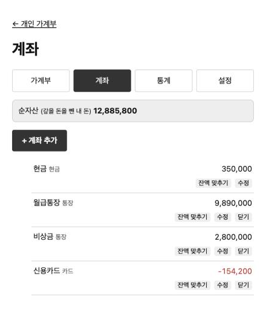
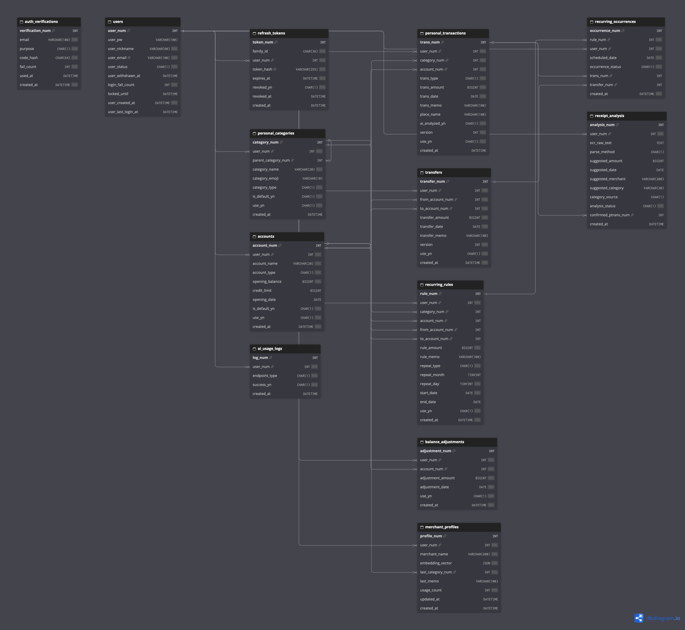

# 도토리 (dotoree) 🌰

**계좌 잔액까지 맞추는 가계부** (AI 영수증 인식은 개발 중) — 24시간 운영하는 실서비스를 목표로 혼자 기획·설계·개발·배포·운영하고 있습니다.

- **기간 · 인원** — 2026.08 ~ 진행 중 · 1인(기획 · 설계 · 개발 · 배포 · 운영)
- **스택** — Java 17 · Spring Boot 4 · Spring Security · MyBatis · MySQL 8.4 · AWS(EC2 · S3 · SES · Route 53 · CloudWatch) · GitHub Actions
- **서비스** — 🔗 **https://dotoree.app** (가입 — 이메일 인증 코드 — 후 써 볼 수 있습니다. 가입 없이 보려면 로그인 화면의 **"데모로 둘러보기"** — 읽기 전용)

<p>
  
  
  
</p>

<sub>가계부 · 계좌 화면은 실제 한 달(2026-10) 거래 내역을 옮겨 넣은 것입니다(가게는 브랜드만, 사람 이름은 메모로 바꿈). 통계 화면은 데모 계정의 예시 데이터입니다.</sub>

---

## 깊게 판 것

설계 결정은 이유·대안·감수한 점을 [ADR](docs/decisions.md) 로 남깁니다(68개). 그중 네 가지입니다.

### 1. 잔액을 저장하지 않고 계산한다 — [ADR-065](docs/decisions.md), [066](docs/decisions.md)
- **문제** — 계좌마다 잔액 칸을 두면 거래를 고치거나 지울 때마다 잔액도 같이 고쳐야 하고, 한 곳만 빠져도 숫자가 어긋난다
- **해결** — 잔액 = 시작 잔액 + 수입 − 지출 + 받은 이체 − 보낸 이체. 기록 하나만 진실로 두고 계산은 서비스 메서드 하나 + SQL 하나에만. 이체 · 잔액 보정은 테이블을 따로 둬 통계 쿼리는 그대로
- **결과** — 잔액이 기록과 어긋날 수 없고, "그날 기준 잔액"도 날짜 조건 하나로 나온다. 느려지면 계산 한 곳의 안쪽만 "월말 스냅샷 + 그 뒤 합"으로 바꾼다

### 2. 훔친 로그인 토큰을 다시 쓰면 그 로그인 전체를 끊는다 — [ADR-055](docs/decisions.md)
- **문제** — Refresh 토큰을 쓸 때마다 새 것으로 바꿔도, 서버는 옛 토큰을 들고 온 쪽이 도둑인지 주인인지 알 수 없다
- **해결** — 로그인 한 번에서 이어진 토큰들을 한 묶음으로 두고, 이미 쓴 토큰이 다시 오면 묶음 전체를 폐기. 응답 유실 · 탭 두 개 동시 갱신은 30초 유예. "이미 썼나 확인 → 바꾸기"를 `UPDATE … WHERE revoked_yn='N'` 한 문장으로 합쳐 동시 요청이 끼어들 틈을 없앴다. 401 을 던져도 폐기는 커밋되게 `noRollbackFor`
- **결과** — 도둑이 토큰을 한 번 쓰면 주인 쪽 다음 요청에서 그 로그인이 통째로 끊긴다. DB 엔 SHA-256 해시만, 쿠키는 `HttpOnly · Secure · SameSite=Strict`

### 3. "맥에서만 통하던" 쿼리를 배포 전에 잡는다 — [트러블슈팅 12](docs/트러블슈팅.md), [ADR-064](docs/decisions.md)
- **문제** — 첫 배포 때 EC2 에서만 `Table 'dotoree.users' doesn't exist`. 원인은 `lower_case_table_names`(맥 2, 리눅스 0). 그때 CI 는 쿼리를 한 번도 실행하지 않았다
- **해결** — CI 에서 운영과 같은 MySQL 8.4 를 일회용으로 띄워 통합 테스트를 돌리고, 하나라도 실패하면 배포를 멈춘다
- **결과** — JUnit 200여 개가 배포 전 관문. 새 기능이 탈퇴 데이터 파기와 FK 로 부딪힌 문제도 운영에 나가기 전에 잡았다

### 4. 백업은 "복원까지 해야 끝" — [ADR-050](docs/decisions.md)
- **문제** — 매일 백업 파일이 쌓여도, 덤프가 중간에 잘렸거나 복원이 안 되면 없는 것과 같다
- **해결** — 서버는 S3 에 넣기만 하고(읽기 · 삭제 권한 없음), 잘린 덤프를 흉내 내 완료 검사를 실측, 별도 DB 에 복원 리허설. 백업이 실패하거나 끊기면 CloudWatch 경보
- **결과** — 서버가 털려도 지난 백업은 지울 수 없고, 복원이 되는 것까지 확인한 백업만 남는다

**그 밖에** — GitHub 에 장기 키 없이 OIDC 1시간 임시 자격 · 배포할 때만 22번 포트 열기([ADR-042](docs/decisions.md), [048](docs/decisions.md)) · 새 마이그레이션은 이전 jar 로 롤백해도 돌아가게([ADR-053](docs/decisions.md)) · 반복 예정은 `(rule_num, scheduled_date)` UNIQUE 로 두 번 눌러도 거래 한 줄([ADR-067](docs/decisions.md)) · 문의 메일도 국내(SES 서울 → S3)에 보관([ADR-056](docs/decisions.md))

## 지금 동작하는 것

| 영역 | 내용 |
|---|---|
| 회원 · 인증 | **이메일 코드 인증 가입(가입하면 바로 로그인)** · 비밀번호 재설정(코드 6자리 · 60초/24시간 5번 · 5번 틀리면 폐기) · 로그인(JWT Access 15분) · **Refresh 토큰 로테이션 + 재사용 탐지 + 유예 30초** · 로그아웃 · 비밀번호 변경 시 전 세션 폐기 · 탈퇴(30일 유예 후 물리 삭제) |
| 개인 가계부 | 수입·지출 CRUD, 월 단위 조회, 낙관적 락으로 동시 수정 충돌 409 |
| 계좌 · 이체 | 현금 · 통장 · 마이너스통장 · 카드 4종, 이체는 거래와 테이블을 나눠 통계에 안 잡힘, **잔액은 저장하지 않고 거래 · 이체에서 계산** |
| 잔액 맞추기 | 은행 앱에 보이는 실제 잔액을 넣으면 서버가 차이만큼 보정(보정도 통계에 안 잡힘) |
| 반복 예정 | 월세 · 카드값 같은 규칙에서 예정을 계산, 확인해야 거래가 됨(금액 · 날짜 고치기 · 이번만 건너뛰기), 두 번 눌러도 한 줄 |
| 카테고리 | 대분류-소분류 2단계, 이모지, 예약어 '미분류', 삭제 시 거래를 같은 타입 미분류로 이관 |
| 통계 | 월별 수입·지출·잔액, 카테고리 봉투(대분류 안에 소분류, 비율은 부모 대비), 수입 0원이면 '계산 불가' |
| 화면 | Vanilla JS 정적 페이지, 다크 모드, Access 만료 시 자동 재발급(동시 요청은 재발급 1번으로 묶음) |
| 개인정보 | 처리방침 공개, 데이터 전부 국내(AWS 서울) 보관 — 문의 메일까지 |

## 구조와 기술 스택

```mermaid
flowchart LR
    U[브라우저] -->|HTTPS| N[Nginx<br/>80→443, /actuator 차단]
    N --> A[Spring Boot<br/>정적 화면 + /api JSON]
    A --> D[(MySQL)]
    D -. 매일 04:00 덤프 .-> S3B[(S3 백업<br/>30일 보관)]
    M[문의 메일] --> SES[SES 수신 · 서울] --> S3M[(S3 메일함<br/>90일 보관)]
    G[GitHub Actions] -->|build(JUnit 200여 개) → qa(스모크) → deploy<br/>OIDC 임시 자격| A
```

- 화면과 API 를 한 프로세스가 서빙합니다(별도 프론트 서버 없음). 계산·판단은 서버, 화면은 표시만 합니다.
- `main` 에 push 하면 **JUnit 단위·통합 테스트 200여 개**가 일회용 MySQL 에서 돌고, 그 빌드의 jar 를 한 번 띄워 헬스 200 을 확인한 뒤 배포합니다. 하나라도 실패하면 배포되지 않습니다.

<details>
<summary><b>ERD</b> — 지금 쓰는 표 10개 + 쓸 예정 3개(receipt_analysis · merchant_profiles · ai_usage_logs)</summary>



계좌에 잔액 칸이 없는 것이 핵심입니다 — 잔액은 거래 · 이체 · 보정에서 계산합니다(ADR-065).
</details>

- **Backend** — Java 17, Spring Boot 4, Spring Security, JWT(jjwt), MyBatis, MySQL 8.4, Flyway
- **Frontend** — Vanilla JavaScript(ES6+), HTML5/CSS3, Fetch API
- **Infra** — AWS EC2(ARM t4g) 한 대에 앱 + MySQL, Nginx + Let's Encrypt, S3(백업·메일함), SES, SNS, Route 53 헬스 체크, CloudWatch, GitHub Actions(OIDC), Cloudflare DNS
- **운영** — systemd, 매일 DB 백업 → S3(복원 리허설까지), 감시는 Route 53 헬스 체크 + CloudWatch 경보(백업·인증서 지표 포함)
- **예정** — Naver Clova OCR, 로컬 LLM(Ollama), 한국어 문장 임베딩

## 문서

| 문서 | 내용 |
|---|---|
| [설계 결정 기록 (ADR)](docs/decisions.md) | 왜 그렇게 결정했는지 |
| [트러블슈팅](docs/트러블슈팅.md) | 겪은 문제와 해결 과정 |

## 로드맵

> 지금은 **Sprint 1(개인 가계부 + 계좌 · 잔액 + 인증 + 배포·운영)** 단계입니다. 영수증·결제내역 캡처 AI 분석(Sprint 2~3)은 설계를 마치고 순서대로 만들고 있습니다.

- **Sprint 1 마무리** — 화면 다듬기, Access 토큰 메모리 보관, 실무 표준 정리(PATCH · Swagger · record · enum · ETag), 시각 UTC 저장
- **Sprint 2** — Clova OCR, 업로드(사진은 저장하지 않음), 정규식 1차 파싱 + LLM 보완, AI 분석 중 DB 커넥션을 잡지 않는 트랜잭션 분리
- **Sprint 3** — 상호명 임베딩 검색으로 카테고리·메모 추천, 정확도 전후 비교
- **Sprint 4** — API 호출 제한(앱 + Nginx), 전체 점검

## 협업 방식

AI 와 페어로 개발합니다. 무엇을 · 왜 만들지는 제가 정하고 ADR 로 남기며, 구현은 AI 에 맡기고 diff · 테스트로 검토합니다. 모든 결정의 "왜"를 제 말로 설명할 수 있게 하는 것이 기준입니다.
