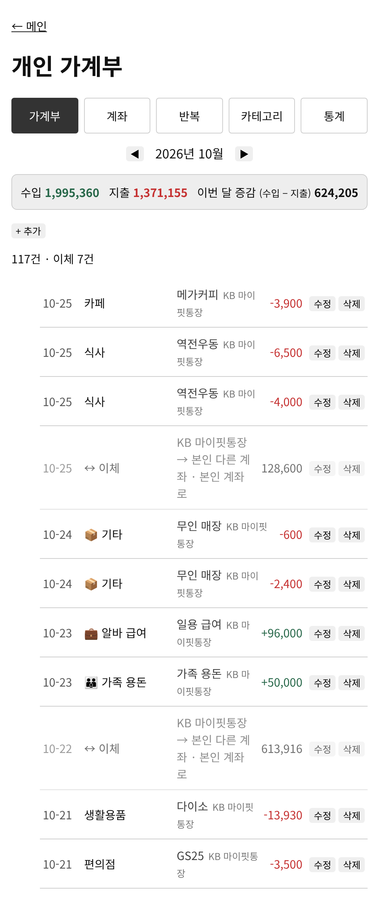
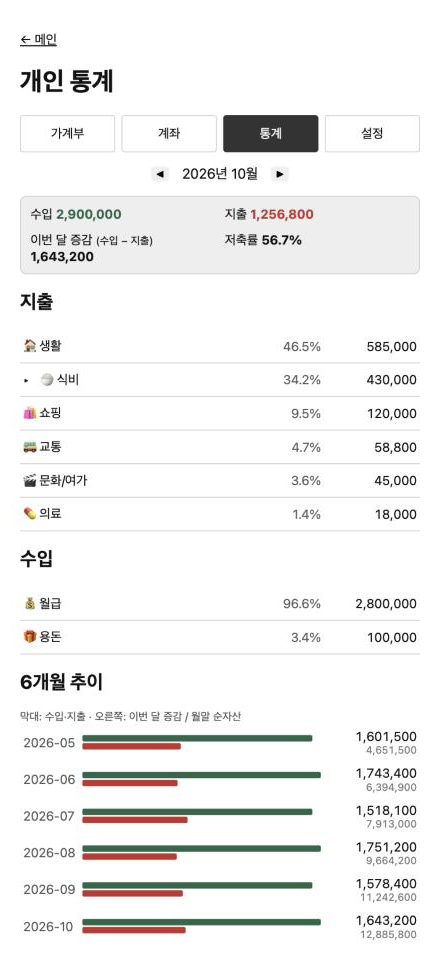

# 도토리 (dotoree) 🌰

**AI 영수증 인식 · 계좌 잔액까지 맞추는 가계부** — 24시간 운영하는 실서비스를 목표로 혼자 기획·설계·개발·배포·운영하고 있습니다.

🔗 **https://dotoree.app** (가입해서 바로 써 볼 수 있습니다)

<p>
  
  
</p>

---

## 깊게 판 것

설계 결정은 이유·대안·감수한 점을 [ADR](docs/decisions.md) 로 남깁니다(68개).

- **잔액은 저장하지 않고 계산(욕조 모델)** — 잔액 = 시작 잔액 + 수입 − 지출 + 받은 이체 − 보낸 이체. 진실은 거래 · 이체 기록 하나라 어긋날 수 없고, 계산은 서비스 메서드 하나 + SQL 하나에만 둡니다. 이체 · 잔액 보정은 테이블을 따로 둬 기존 통계 쿼리를 건드리지 않았고, 느려지면 계산 한 곳의 안쪽만 "월말 스냅샷 + 그 뒤 합"으로 바꿉니다 ([ADR-065](docs/decisions.md), [066](docs/decisions.md))
- **Refresh 토큰을 "도둑과 주인을 구분할 수 없다"는 전제에서 설계** — 로그인 한 번을 패밀리로 묶고, 폐기된 토큰이 다시 오면 패밀리 전체 회수. 응답 유실·탭 두 개 동시 갱신은 30초 유예로 봐주되, 전체 폐기 직후의 부활 시도는 "살아 있는 토큰이 있나"로 막음. 거절(401)을 던져도 회수는 커밋되도록 `noRollbackFor` — 기본값이면 롤백돼 도둑이 새 토큰을 들고 남습니다. 원문은 SecureRandom 32바이트, DB 엔 SHA-256 만, 쿠키는 `HttpOnly · Secure · SameSite=Strict · Path=/api/auth` ([ADR-055](docs/decisions.md))
- **check-then-act 를 UPDATE 한 문장으로** — 동시 재발급은 `UPDATE … WHERE revoked_yn='N'` 의 영향 행 수로, 유예 판정도 회수 UPDATE 의 반환값으로. 조회 후 갱신 사이에 다른 요청이 끼어들 틈을 없앴습니다. 반복 예정 확인은 `(rule_num, scheduled_date)` UNIQUE 로 두 번 눌러도 거래가 한 줄입니다 ([ADR-067](docs/decisions.md))
- **"맥에서만 통하던" 쿼리를 배포 전에 잡기** — 첫 배포 때 EC2 에서만 `Table 'dotoree.users' doesn't exist`. 원인은 `lower_case_table_names`(맥 2, 리눅스 0). CI 가 쿼리를 한 번도 실행하지 않았다는 걸 알고, 일회용 MySQL 에서 통합 테스트를 돌려 실패하면 배포를 멈추는 게이트를 세웠습니다 ([트러블슈팅 12](docs/트러블슈팅.md), [ADR-064](docs/decisions.md))
- **배포 게이트와 비밀 관리** — GitHub 에 장기 액세스 키를 두지 않고 OIDC 1시간 임시 자격, 배포할 때만 러너 IP 를 22번에 열고 닫기. 값은 "비밀 / 식별자 / 공개 설정" 3단으로 나눠 공개 저장소·공개 CI 로그에 새지 않게 ([ADR-042](docs/decisions.md), [047](docs/decisions.md), [048](docs/decisions.md))
- **운영을 "복원까지 해야 끝"으로** — 백업은 서버가 S3 에 넣기만 하고(읽기·삭제 권한 없음), 잘린 덤프를 흉내 내 완료 검사를 실측, 별도 DB 에 복원 리허설 ([ADR-050](docs/decisions.md))
- **forward-only 마이그레이션** — 새 V 파일은 이전 jar 로 롤백해도 돌아가게 ([ADR-053](docs/decisions.md))
- **개인정보를 국내에** — 문의 메일이 미국(Gmail)을 거치던 것을 SES 서울 수신 → S3 로 옮겨 국외 이전 자체를 없앰. 알림에는 보낸 사람 정보가 담기지 않게 S3 이벤트로 ([ADR-056](docs/decisions.md))

## 지금 동작하는 것

| 영역 | 내용 |
|---|---|
| 회원 · 인증 | **이메일 코드 인증 가입(가입하면 바로 로그인)** · 비밀번호 재설정(코드 6자리 · 60초/24시간 5번 · 5번 틀리면 폐기) · 로그인(JWT Access 15분) · **Refresh 토큰 로테이션 + 재사용 탐지 + 유예 30초** · 로그아웃 · 비밀번호 변경 시 전 세션 폐기 · 탈퇴(30일 유예 후 물리 삭제) |
| 개인 가계부 | 수입·지출 CRUD, 월 단위 조회, 낙관적 락으로 동시 수정 충돌 409 |
| 계좌 · 이체 | 현금 · 통장 · 마이너스통장 · 카드 4종, 이체는 거래와 테이블을 나눠 통계에 안 잡힘, **잔액은 저장하지 않고 거래 · 이체에서 계산** |
| 잔액 맞추기 | 은행 앱에 보이는 실제 잔액을 넣으면 서버가 차이만큼 보정(보정도 통계에 안 잡힘) |
| 반복 예정 | 월세 · 카드값 같은 규칙에서 예정을 계산, 확인해야 거래가 됨(금액 · 날짜 고치기 · 이번만 건너뛰기), 두 번 눌러도 한 줄 |
| 카테고리 | 대분류-소분류 2단계, 이모지, 예약어 '미분류', 삭제 시 거래를 같은 타입 미분류로 이관 |
| 통계 | 월별 수입·지출·잔액, 카테고리 봉투(대분류 안에 소분류, 비율은 부모 대비), 수입 0원이면 '계산 불가' |
| 화면 | Vanilla JS 정적 페이지, 다크 모드, Access 만료 시 자동 재발급(동시 요청은 재발급 1번으로 묶음) |
| 개인정보 | 처리방침 공개, 데이터 전부 국내(AWS 서울) 보관 — 문의 메일까지 |

## 구조와 기술 스택

```mermaid
flowchart LR
    U[브라우저] -->|HTTPS| N[Nginx<br/>80→443, /actuator 차단]
    N --> A[Spring Boot<br/>정적 화면 + /api JSON]
    A --> D[(MySQL)]
    D -. 매일 04:00 덤프 .-> S3B[(S3 백업<br/>30일 보관)]
    M[문의 메일] --> SES[SES 수신 · 서울] --> S3M[(S3 메일함<br/>90일 보관)]
    G[GitHub Actions] -->|build(JUnit 200여 개) → qa(스모크) → deploy<br/>OIDC 임시 자격| A
```

- 화면과 API 를 한 프로세스가 서빙합니다(별도 프론트 서버 없음). 계산·판단은 서버, 화면은 표시만 합니다.
- `main` 에 push 하면 **JUnit 단위·통합 테스트 200여 개**가 일회용 MySQL 에서 돌고, 그 빌드의 jar 를 한 번 띄워 헬스 200 을 확인한 뒤 배포합니다. 하나라도 실패하면 배포되지 않습니다.

- **Backend** — Java 17, Spring Boot 4, Spring Security, JWT(jjwt), MyBatis, MySQL 8.4, Flyway
- **Frontend** — Vanilla JavaScript(ES6+), HTML5/CSS3, Fetch API
- **Infra** — AWS EC2(ARM t4g) 한 대에 앱 + MySQL, Nginx + Let's Encrypt, S3(백업·메일함), SES, SNS, Route 53 헬스 체크, CloudWatch, GitHub Actions(OIDC), Cloudflare DNS
- **운영** — systemd, 매일 DB 백업 → S3(복원 리허설까지), 감시는 Route 53 헬스 체크 + CloudWatch 경보(백업·인증서 지표 포함)
- **예정** — Naver Clova OCR, 로컬 LLM(Ollama), 한국어 문장 임베딩

## 문서

| 문서 | 내용 |
|---|---|
| [설계 결정 기록 (ADR)](docs/decisions.md) | 왜 그렇게 결정했는지 |
| [트러블슈팅](docs/트러블슈팅.md) | 겪은 문제와 해결 과정 |

## 로드맵

> 지금은 **Sprint 1(개인 가계부 + 계좌 · 잔액 + 인증 + 배포·운영)** 단계입니다. 영수증·결제내역 캡처 AI 분석(Sprint 2~3)은 설계를 마치고 순서대로 만들고 있습니다.

- **Sprint 1 마무리** — 화면 다듬기, Access 토큰 메모리 보관, 실무 표준 정리(PATCH · Swagger · record · enum · ETag), 시각 UTC 저장
- **Sprint 2** — Clova OCR, 업로드(사진은 저장하지 않음), 정규식 1차 파싱 + LLM 보완, AI 분석 중 DB 커넥션을 잡지 않는 트랜잭션 분리
- **Sprint 3** — 상호명 임베딩 검색으로 카테고리·메모 추천, 정확도 전후 비교
- **Sprint 4** — API 호출 제한(앱 + Nginx), 전체 점검

## 협업 방식

AI 와 페어로 개발합니다. 무엇을 · 왜 만들지는 제가 정하고 ADR 로 남기며, 구현은 AI 에 맡기고 diff · 테스트로 검토합니다. 모든 결정의 "왜"를 제 말로 설명할 수 있게 하는 것이 기준입니다.
